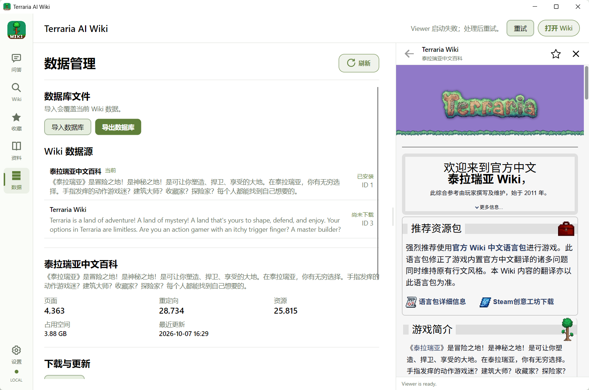
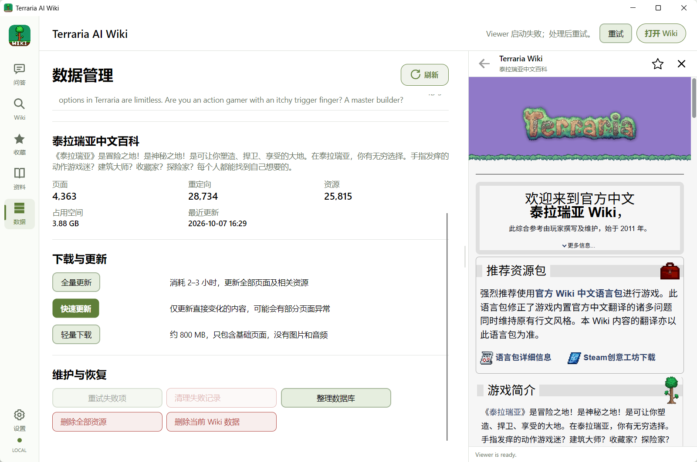
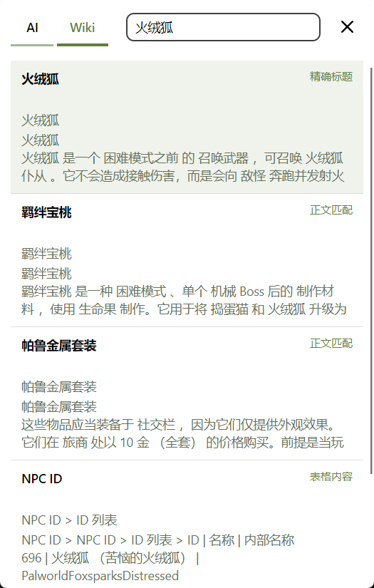
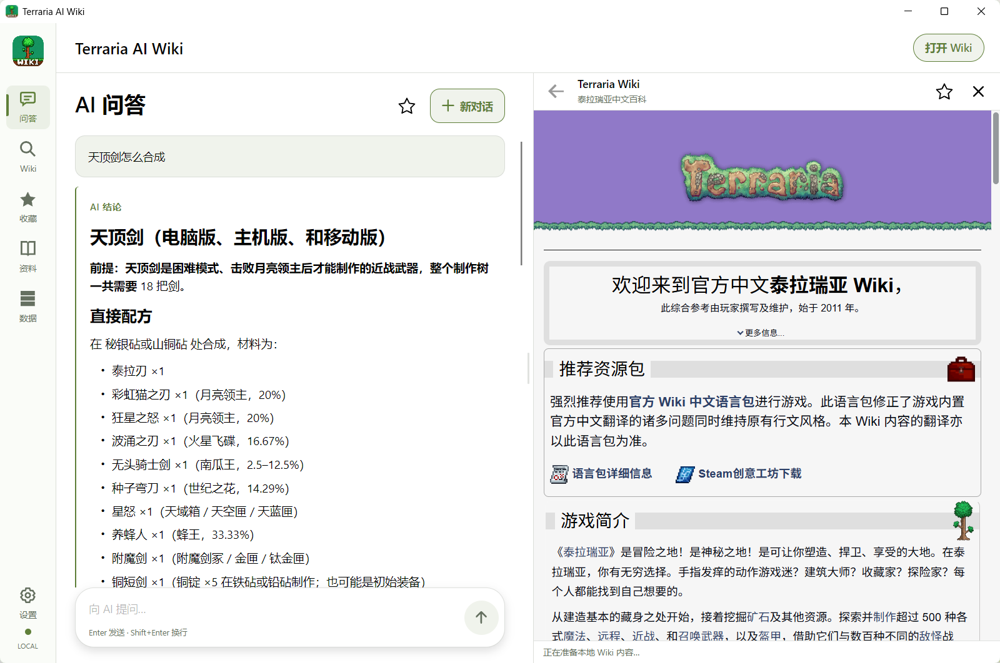
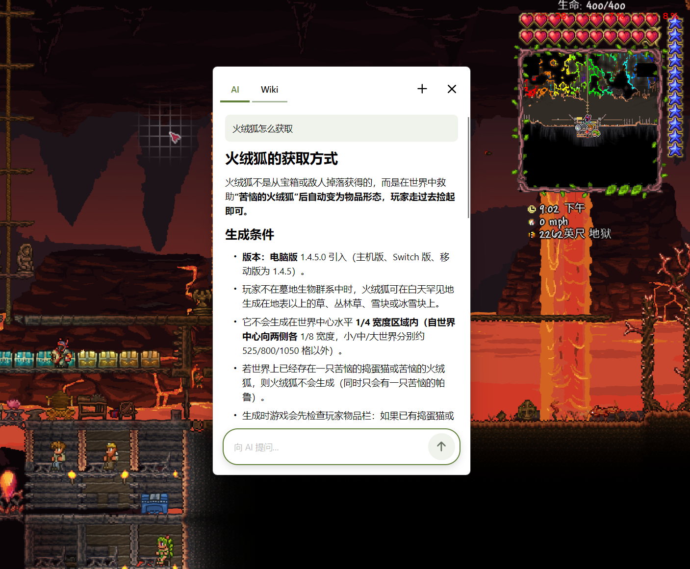
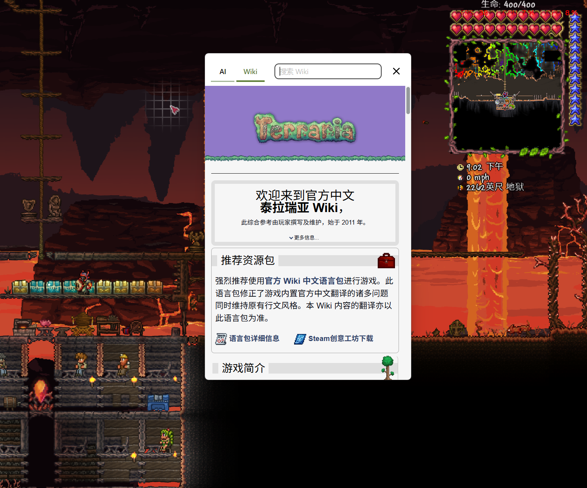

# Terraria AI Wiki

一个面向 Terraria 玩家的 Windows 应用，将本地 Wiki、离线阅读与 AI 问答结合起来。你可以搜索物品、Boss 和合成配方，也可以用自然语言提问，让 AI 查阅本地 Wiki 并给出资料来源。

## 功能与使用

### Wiki 数据管理

首次使用时，进入「数据」页面，选择要使用的 Wiki，下载数据或导入兼容的本地 `.db` 数据库。全量下载包含页面和媒体资源；轻量下载只包含页面。你可以执行全量更新或快速更新，也可以通过单个 `.db` 文件备份、交换 Wiki 数据。

### 搜索与离线阅读

在「Wiki」页面输入关键词，查看匹配的词条与章节，点击结果打开正文。已下载的页面可以离线阅读；图片和音频是否可用取决于下载的数据。常用页面可以加入收藏。

### AI 问答

在「设置 → AI 配置」中选择模型服务并保存配置，然后用自然语言提问。AI 会搜索并读取本地 Wiki，再组织回答；点击回答附带的来源即可核对原文。对话会保存在本机，也可以收藏整段对话。

AI 问答需要联网访问所配置的模型服务，服务可能收费；问题、近期对话和相关 Wiki 摘录会发送给该服务。AI 回答可能有误，请结合引用资料判断。

### Quick Ask 快捷查询

Quick Ask 是一个可随时唤起的小窗口，方便在游玩时提问或查询 Wiki。窗口支持 AI 与 Wiki 模式切换；AI 来源可以直接在小窗口内打开。默认按 **Ctrl+O** 唤起，也可以从托盘菜单打开。快捷键可在设置中修改。

## 源码目录

- `src/`：C# Wiki Core、Application、Wiki Tools、Avalonia Windows 客户端和 Viewer 宿主源码。
- `agent/`：Python AI Agent 与 Sidecar 源码。
- `assets/windows/Viewer/`：内嵌 Wiki Viewer 的 HTML、JavaScript 和 CSS 源码。

当前客户端使用 .NET、Avalonia 和 WebView2；AI 部分使用 Python 与 Pydantic AI。当前产品目标为 Windows，Android 尚未实现。

## 仓库范围

此远程仓库当前提供产品源码、本 README 和上面的界面截图。开发计划、测试、构建脚本、项目与依赖配置、数据库和发布制品不在发布范围内，因此该源码快照不能直接构建或运行。

## 来源与权利

本项目基于 [BigBearKing/terraria-wiki-offline](https://github.com/BigBearKing/terraria-wiki-offline) 演进，Viewer 资产来源快照对应上游提交 `a1dd899`。第三方源码、组件和素材保留各自适用的许可与权利声明。项目自有源码采用与上游相同的 [CC BY-NC-SA 4.0](https://creativecommons.org/licenses/by-nc-sa/4.0/deed.zh-hans) 协议。

本项目为非官方项目，与 Re-Logic、wiki.gg 或 Calamity Mod 团队无隶属或背书关系。Terraria 及相关名称、商标和游戏素材属于各自权利人。
