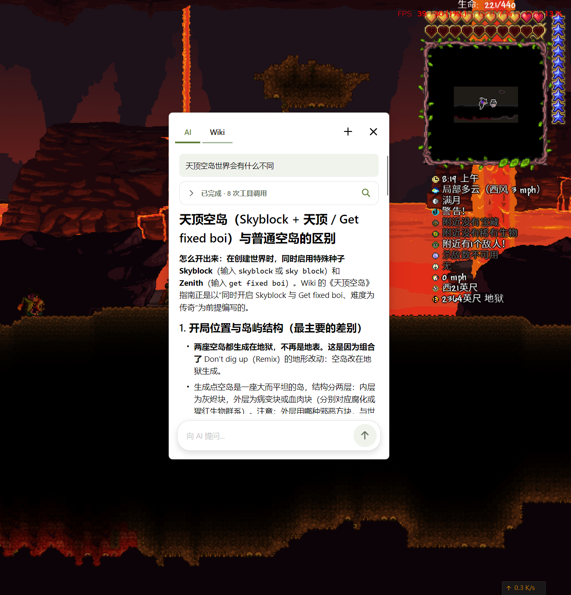
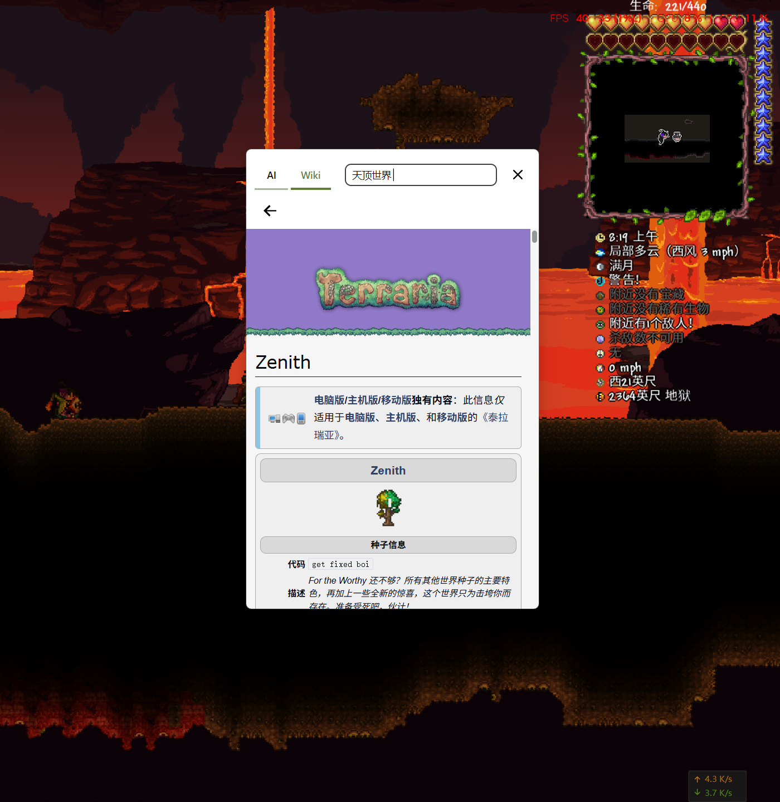
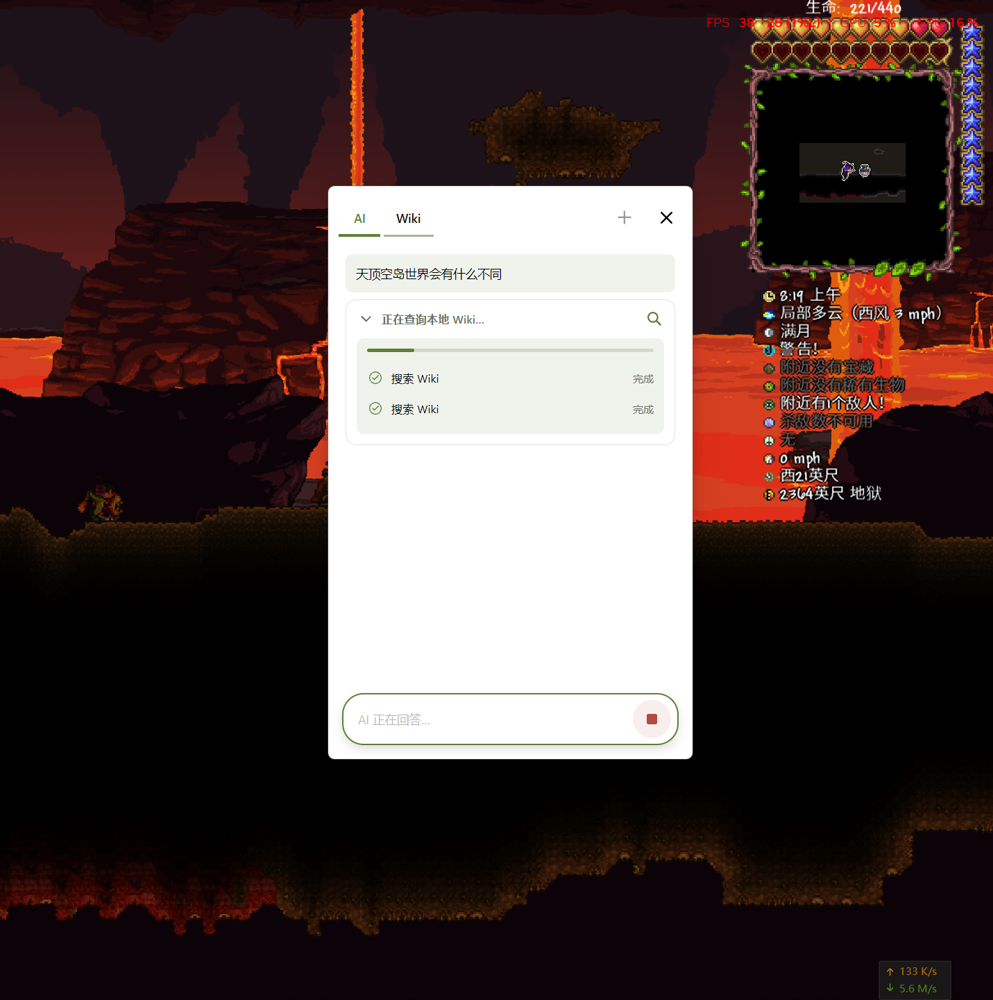
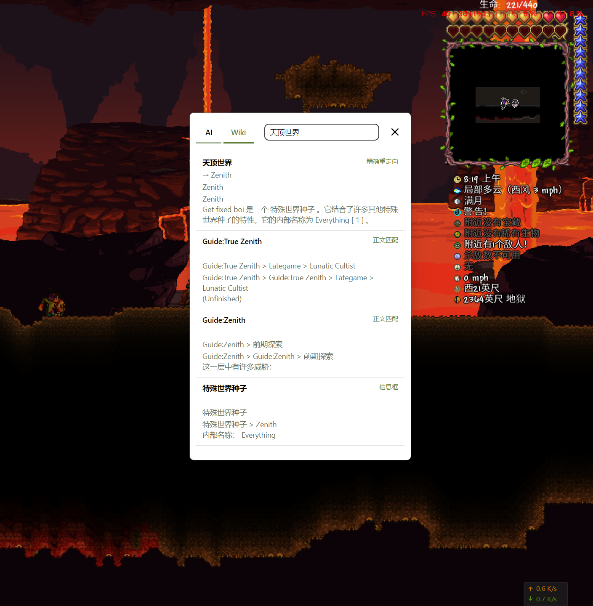
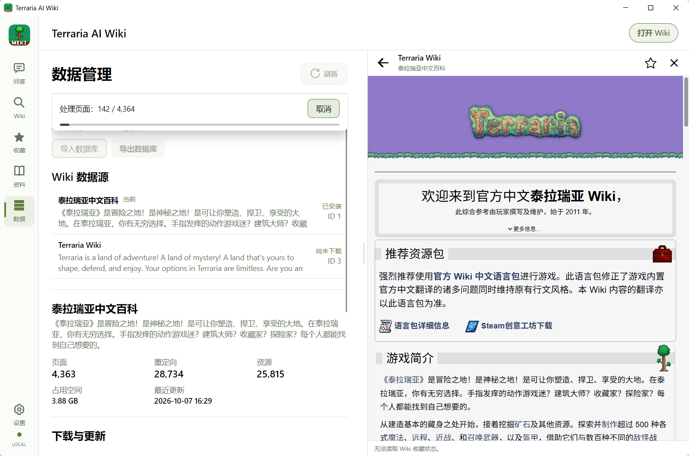
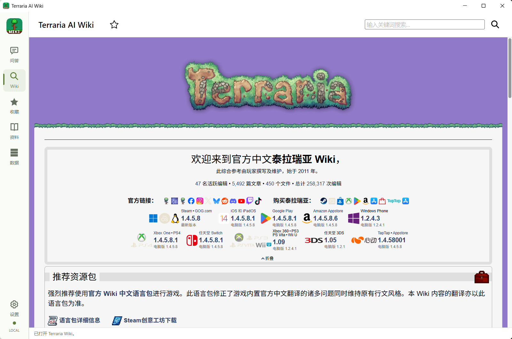
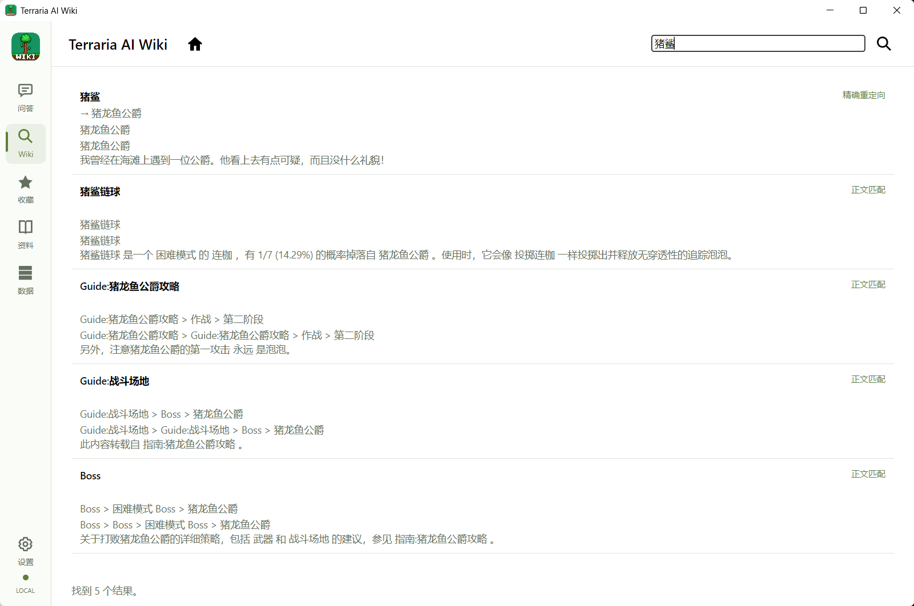
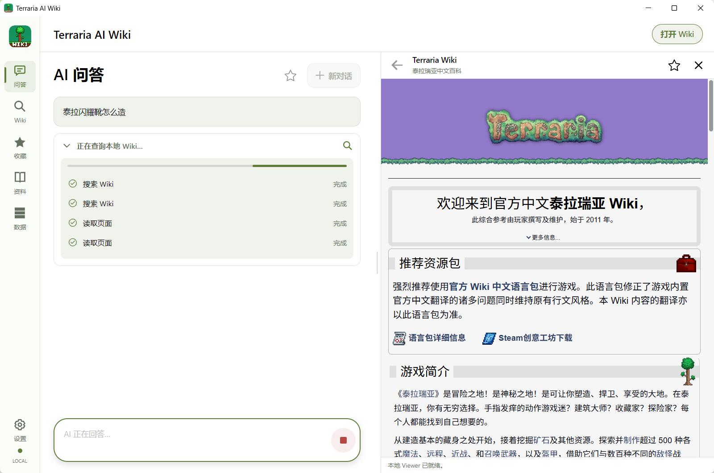
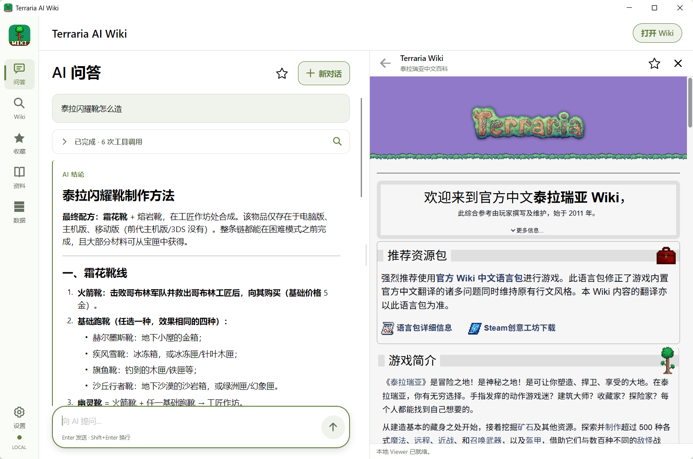

# Terraria AI Wiki

Terraria AI Wiki 是一个面向 Terraria 玩家的 Windows 应用。
 **Quick Ask 快捷查询**：游玩时按下快捷键，就能在小窗口里查询物品、Boss、合成配方和攻略，让 AI 查阅本地 Wiki 回答，或直接打开 Wiki 原文。

## Quick Ask：游玩时的快捷查询窗口

遇到不认识的物品、忘记合成路线，或想查特殊世界的规则时，默认按 **Ctrl+O** 唤起 Quick Ask，点击小窗口即可输入。窗口内支持 **AI / Wiki** 两种模式，无需先切回完整主窗口。

### 用自然语言问 AI

例如「天顶空岛世界会有什么不同？」。AI 会搜索、读取本地 Wiki，并显示查询过程，再整理成回答；回答附带的 Wiki 来源可以直接在小窗口内打开核对。

### 直接搜索和阅读 Wiki

切换到 **Wiki**，输入关键词即可查看匹配的词条与章节，点击结果打开正文。已下载的内容可以离线阅读；图片与音频是否可用取决于下载的数据。

查看 AI 查询过程与 Wiki 搜索结果

### 唤起、隐藏与继续查询

| 操作 | 默认方式 |
|---|---|
| 唤起 Quick Ask | **Ctrl+O**，或托盘菜单 → Quick Ask |
| 隐藏小窗口 | **Ctrl+P**、窗口内按 **Esc**，或点击关闭按钮 |
| 调整快捷键与窗口偏好 | 设置 → 常规设置 → Quick Ask |
| 完全退出应用 | 托盘菜单 → 退出 |

隐藏窗口会保留草稿、对话与阅读位置，也不会中断正在生成的回答。Quick Ask 与主窗口各自保留当前对话；同一时间只能在一个窗口生成 AI 回答。

可以设置默认打开 AI 或 Wiki、是否置顶，以及关闭主窗口后是否留在托盘。已有自定义快捷键时，以设置中的绑定为准。游戏建议使用窗口或无边框模式；独占全屏下的显示效果不作保证。

## 开始使用

1. **准备本地 Wiki**：进入「数据」页面，选择 Wiki 后下载数据，或导入格式与 Wiki 身份匹配的 `.db` 数据库。全量下载包含页面及媒体资源，轻量下载只包含页面；后续可以全量更新、快速更新，或导出数据库备份。
2. **配置 AI（使用 AI 问答时）**：进入「设置 → AI 配置」，选择模型服务，填写 API Key 和模型；自定义服务还需填写服务地址与 API 类型，确认后保存配置。
3. **开始查询**：让应用保持运行，游玩时按 **Ctrl+O** 唤起 Quick Ask，选择 AI 或 Wiki 模式。

AI 问答需要联网访问所配置的模型服务，服务可能收费；问题、近期对话和相关 Wiki 摘录会发送给该服务。AI 回答可能有误，请结合引用资料判断。

## 主窗口：阅读与整理资料

主窗口提供更宽的 Wiki 阅读区域，也可以直接搜索词条与章节、收藏常用页面，并查看保存在本机的对话历史或收藏整段对话。设置中支持浅色／暗色主题和简体中文／English (US) 界面；界面语言不会改变 Wiki 原文。

查看主窗口截图

Wiki 首页：

搜索「猪鲨」：

AI 搜索和读取本地 Wiki：

AI 回答与侧栏 Wiki 阅读：

## 来源与权利

本项目基于 [BigBearKing 的 Terraria Wiki Offline](https://github.com/BigBearKing/terraria-wiki-offline) 发展而来，复用部分原有代码与资源，并开发了新的 Windows 界面、AI 问答与 Quick Ask 快捷查询功能。感谢原作者、[Terraria Wiki](https://terraria.wiki.gg/) 社区贡献者和第三方组件作者的工作。

项目自有源码采用与上游相同的 [CC BY-NC-SA 4.0（署名—非商业性使用—相同方式共享）](https://creativecommons.org/licenses/by-nc-sa/4.0/deed.zh-hans) 协议。分享和修改时须保留署名、注明修改，不得用于商业用途，衍生作品须按相同协议分享；第三方组件、Wiki 内容、图片与音频保留各自适用的许可与权利声明。

本应用为非官方爱好者项目，与 Re-Logic、wiki.gg 无隶属或背书关系。《Terraria》及相关名称、商标和游戏素材属于各自权利人。
